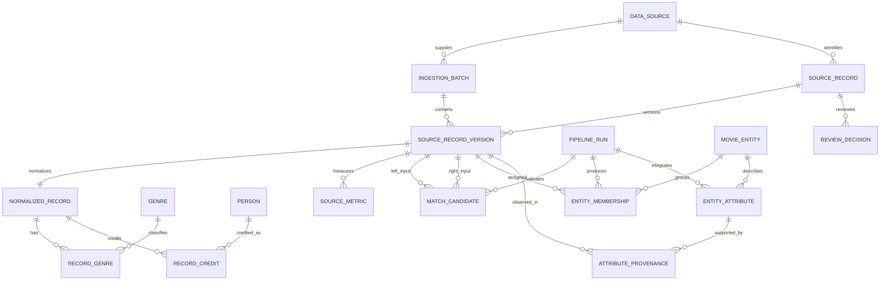

# Movie Integration Platform — Database Design (v1)

**Status:** Proposed schema for review; not yet wired into the Flask pipeline.  
**Target:** SQLite using Python's standard-library `sqlite3`.  
**Design basis:** Current MovieLens `movies.csv`, MovieLens `links.csv`, TMDB 5000 movies and TMDB 5000 credits datasets, plus the existing four-engine pipeline.

## 1. Design decisions

1. A source record is identified by the pair `(source, external_id)`. MovieLens movie ID `1` and TMDB movie ID `1` are not the same identifier.
2. Raw source payloads are immutable snapshots. Normalization creates a separate standardized representation and never overwrites source values.
3. Re-imports are represented as batches and source-record versions. This preserves history and lets us compare pipeline runs reproducibly.
4. TMDB credits are joined to the TMDB movie record using TMDB's movie ID, then stored as people and role-specific credits. Credits are not a second movie record.
5. Genres use a many-to-many relationship, not a comma-separated field.
6. Match candidates and entity membership are separate. A candidate is pairwise evidence; membership is a clustering result for a particular run.
7. Entity membership is run-scoped. Re-running a new matcher does not erase previous assignments.
8. Human decisions reference stable source-record identities, not transient candidate IDs, so they can survive a new import/version.
9. Integrated values retain attribute-level provenance. Source priority is not hard-coded as the only resolution policy.
10. MovieLens user ratings and TMDB aggregate vote averages are different measurements. They must not be converted and merged as if they were the same thing.
11. `links.csv` is evaluation-only. It must not be loaded into the production database or passed to candidate generation, scoring, clustering or integration. Keep it in a separate evaluation store/process boundary.

## 2. Entity relationship diagram

`links.csv` and the manually labelled hard-case set are intentionally outside this production ERD. They belong to an isolated evaluation dataset.

## 3. Tables and responsibilities

| Table | Key / important columns | Responsibility |
|---|---|---|
| `data_source` | `source_id` PK, `source_code` UNIQUE | Source namespace (MovieLens, TMDB, IMDb). |
| `ingestion_batch` | `batch_id` PK, `source_id` FK | One file import, checksum, counts and status. |
| `source_record` | `record_id` PK, UNIQUE(`source_id`,`external_id`) | Stable identity of one source's movie record. |
| `source_record_version` | `record_version_id` PK, `record_id` FK, `batch_id` FK | Immutable raw snapshot from a particular import. |
| `normalized_record` | `record_version_id` PK/FK | Canonical title, normalized title, year and overview. |
| `genre` | `genre_id` PK, `canonical_name` UNIQUE | Controlled genre vocabulary. |
| `record_genre` | PK(`record_version_id`,`genre_id`) | Many-to-many association; retains source label. |
| `person` | `person_id` PK, optional unique `tmdb_person_id` | Director/cast/crew identity. |
| `record_credit` | `credit_id` PK, record/person FKs, role | Director, cast and crew credits for a record version. |
| `source_metric` | PK(`record_version_id`,`metric_name`) | Source-specific aggregate metrics and scale metadata. |
| `pipeline_run` | `run_id` PK, version/config/status | Reproducible pipeline execution. |
| `match_candidate` | `candidate_id` PK, run and record-version FKs | Candidate pair, blocking methods, component scores and decision. |
| `movie_entity` | `entity_id` PK | Identity of a unified movie entity. |
| `entity_membership` | PK(`run_id`,`record_version_id`) | Which source-record versions belong to which entity in a run. |
| `entity_attribute` | PK(`run_id`,`entity_id`,`attribute_name`,`value_ordinal`) | Selected or competing integrated attribute values. |
| `attribute_provenance` | Composite FK to entity attribute + record-version FK | Which source records support, conflict with or supplied a value. |
| `review_decision` | `review_id` PK, stable source-record pair | Persistent human match/non-match decisions and decision history. |
| `recommendation_user`, `user_rating` | User and rating event keys | Optional later collaborative-filtering extension; not part of current metadata pipeline. |

## 4. Functional dependencies and normal forms

### Core functional dependencies

- `data_source`: `source_id -> source_code, display_name`; `source_code -> source_id, display_name`.
- `source_record`: `record_id -> source_id, external_id`; `(source_id, external_id) -> record_id`.
- `ingestion_batch`: `batch_id -> source_id, source_filename, file_sha256, status, ...`.
- `source_record_version`: `record_version_id -> record_id, batch_id, source_row_number, raw_payload`; `(record_id, batch_id) -> record_version_id`.
- `normalized_record`: `record_version_id -> original_title, normalized_title, release_year, overview, normalization_version, ...`.
- `genre`: `genre_id -> canonical_name`; `canonical_name -> genre_id`.
- `record_genre`: `(record_version_id, genre_id) -> source_label`.
- `person`: `person_id -> display_name, tmdb_person_id`; `tmdb_person_id -> person_id` when non-NULL.
- `movie_entity`: `entity_id -> created_at`.
- `entity_membership`: `(run_id, record_version_id) -> entity_id, membership_method, confidence`.
- `entity_attribute`: `(run_id, entity_id, attribute_name, value_ordinal) -> attribute_value, value_data_type, resolution_method, is_selected`.
- `attribute_provenance`: `(run_id, entity_id, attribute_name, value_ordinal, record_version_id) -> observed_source_value, contribution`.

### 1NF

All relational columns hold one value. Genre membership and credits are represented as rows in child tables, not delimited lists in a cell. Raw JSON is retained as an immutable source payload for audit/replay, not used as a substitute for normalized relational attributes.

### 2NF

Relations with composite keys have no non-key attribute depending on only part of the key. For example, in `record_genre`, the source label describes the association between a particular record version and a particular genre. In `entity_attribute`, the value and resolution metadata depend on the full composite key.

### 3NF

Source names are held in `data_source`, genre names in `genre`, and person identities in `person`; dependent descriptive attributes are not repeated in every movie row. The schema avoids storing `source_name` beside `source_id` in `source_record`, or `genre_name` beside `genre_id` in `record_genre`.

### BCNF

For the listed core relations, each non-trivial determinant is a candidate key or superkey under the stated dependencies. This is checked relation by relation, not assumed merely because a table is in 3NF. If future business rules introduce dependencies such as `credit_role + person -> ...`, revisit the relevant relation rather than asserting BCNF without proof.

## 5. Important boundaries and data semantics

### Evaluation isolation

`links.csv` maps MovieLens IDs to TMDB IDs. It is a label source, not a matcher input. Store evaluation labels in a separate file/database and expose them only to the evaluator. The matcher API should accept production source-record features only; it must not receive a ground-truth connection, mapping dictionary or label table. Split labels into tuning/validation/test partitions before weight tuning. Unknown/unlabelled pairs must not automatically be treated as negatives.

The manual hard-case dataset (sequels, remakes, same-title different movies) is also evaluation data. Keep its labels and rationale separate from production matching inputs.

### Identifiers

Do not infer cross-source identity from equal numeric IDs. Use `(source_code, external_id)` as a namespace. Exact-ID matching can only use identifiers genuinely present in the source records being matched; the evaluation-only `links.csv` mapping cannot be copied into MovieLens records.

### Ratings

TMDB `vote_average` is an aggregate source metric. MovieLens `ratings.csv` contains user-item rating events. They have different semantics and populations. Store them separately. Do not multiply MovieLens values by two and call the result a comparable TMDB rating.

### Credits

Parse `tmdb_5000_credits.csv` JSON and join it to `tmdb_5000_movies.csv` by TMDB movie ID. Store people and role-specific credit rows. Do not treat the credits CSV as a new independent movie source.

## 6. Indexes and constraints

The SQL schema adds indexes for source identifier lookup, batch version lookup, normalized title/year candidate retrieval, genre/person joins, candidate decisions/scores, entity membership and review-pair history. These are initial hypotheses; validate with `EXPLAIN QUERY PLAN` and measured query timings before adding more indexes.

Important integrity rules include source-scoped external-ID uniqueness, one raw snapshot per record per batch, one normalized row per raw version, unique genre vocabulary, candidate pair canonical ordering, one membership per record version per run, confidence/similarity bounds, and foreign-key enforcement.

## 7. Deliberate non-goals for schema v1

- No separate table for every CSV column.
- No PostgreSQL-specific features; SQLite standard-library compatibility comes first.
- No collaborative-filtering implementation yet. The optional user-rating tables only reserve a clean place for that future extension.
- No evaluation labels in the production database.
- No claim that a schema is BCNF without checking its functional dependencies.

## 8. Implementation order after schema approval

1. Create the database connection helper with `PRAGMA foreign_keys=ON` for every connection.
2. Add a versioned migration runner and apply `schema_v1.sql` transactionally.
3. Add repository functions for sources, batches, source records and immutable versions.
4. Ingest TMDB credits into `person` and `record_credit`.
5. Persist normalized rows and genres.
6. Persist run-scoped candidates, memberships, integrated attributes and provenance.
7. Persist manual review decisions against stable source-record IDs.
8. Keep evaluation loading and scoring in a separate module/store with no matcher dependency on it.

**This document and SQL file define the proposed schema only. The existing JSON pipeline has not been modified or replaced.**
